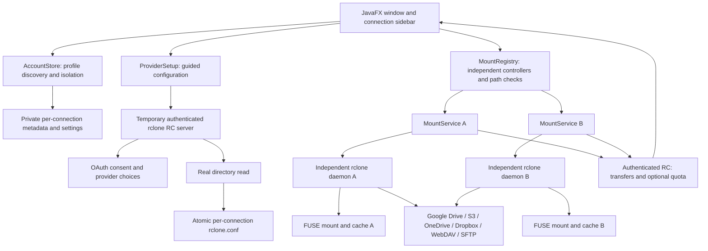

# Architecture

`CloudAccount` is a nonsecret descriptor with a UUID, name, provider and remote folder. `AccountStore` scopes config,
cache and state under that ID. Each scoped config keeps the same internal remote name `cloudmount`; the files and engine
processes are separate, so accounts cannot overwrite one another. The original root Google credentials/settings/state
remain a legacy profile at their existing paths. No automatic data migration or daemon restart occurs.

`Provider` supplies curated forms and validation for seven setup types. Google app-client configuration can be imported
once through `OAuthClientStore`. S3 supports supplied credentials or the AWS credential chain; S3-compatible endpoints
use generic provider/path-style addressing. SFTP requires an existing known-hosts file.

`ProviderSetup` starts a temporary authenticated loopback `rclone rcd` against a staged private config. It drives
`config/create` and `config/update` with rclone's noninteractive state machine, passing answers back from JavaFX
dialogs. Long operations are asynchronous RC jobs. The app handles the local-browser choice and surfaces the allowlisted
loopback URL from `config/oauthstatus`. The bundled response template applies to every OAuth backend. Setup checks an
actual directory read, stops its own setup server, and atomically replaces credentials. Cancellation/failure retains the
old config. A fresh cache identity prevents cross-account cache reuse after reconnection.

`MountRegistry` owns one controller per connection. It checks canonical local paths against all saved profiles,
preventing mount overlap and mount/cache nesting even through symlinks. Each `MountService` launches an independent
`rclone mount --daemon`, passing the chosen remote folder and volume name. Its private `MountSession` records settings,
a unique FUSE device, RC password, PID and process start time. Restoring validates filesystem ownership and process
identity; explicit unmount checks writes and detaches/stops only that verified engine. Closing JavaFX does not signal
mount daemons.

Background operations run on Java virtual threads. Transfer polling is independent per account, bounded to one in-flight
poll per connection, with JavaFX updates through `Platform.runLater`. Quota uses `operations/about`; failure/unsupported
capacity remains unknown without disabling transfer monitoring. `TransferSnapshot` combines active operations, disk
cache state and queued uploads. UI getters do not wait on the mount controller's network-operation lock.

`SettingsStore` and `PrivateFiles` write preferences/credentials atomically with owner-only permissions. Secrets are
absent from metadata and process arguments. The app has a single-window file lock. It never changes the user's global
rclone config. Caches survive unmount, connection removal, errors and restarts.

Contracts: [rclone configuration RC API](https://rclone.org/rc/#config-create), [configuration state machine](https://github.com/rclone/rclone/blob/v1.76.0/fs/backend_config.go), [mount](https://rclone.org/commands/rclone_mount/), [JavaFX](https://openjfx.io/).
The old `GoogleDriveService` remains for compatibility tests; the frontend now uses generic `ProviderSetup`.
